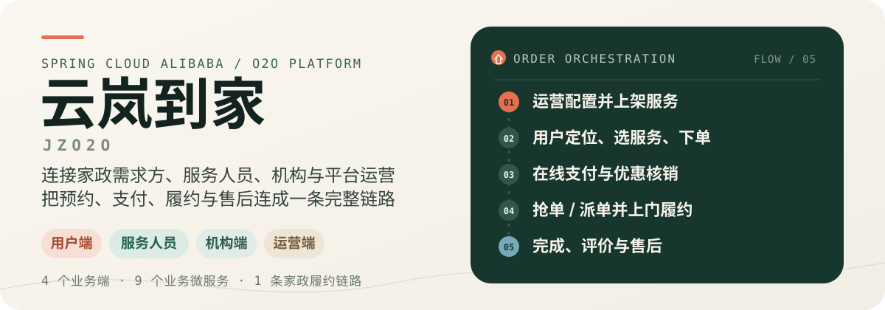
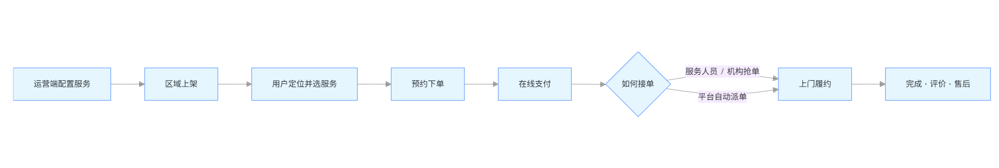
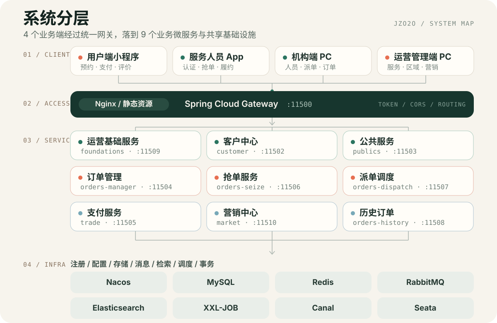

<p align="center">
  
</p>

<p align="center">
  <a href="https://github.com/lining-lo/jzo2o"></a>
  
  
  
  
  
  
  
</p>

<p align="center">
  <strong>4 个业务端 · 9 个业务微服务 · 1 条家政履约链路</strong><br>
  <sub>Spring Cloud Alibaba · 多角色 O2O · 订单驱动</sub>
</p>

<p align="center">
  <a href="#项目定位">项目定位</a> ·
  <a href="#业务闭环">业务闭环</a> ·
  <a href="#系统架构">系统架构</a> ·
  <a href="#快速开始">快速开始</a> ·
  <a href="#常见问题">常见问题</a>
</p>

## 项目定位

**云岚到家**是一个连接家政需求方、服务人员、家政机构与平台运营方的家政服务 O2O 平台。项目采用前后端分离与 Spring Cloud Alibaba 微服务架构，围绕“服务上架 → 用户预约下单 → 在线支付 → 抢单/派单 → 上门服务 → 订单完成 → 评价与售后”组织完整业务链路。

它不是只展示几个接口的单体 CRUD，而是一个把**多角色协作、订单状态流转、支付营销和分布式基础设施**放在同一套工程里的实践项目。

> **定位说明**：本项目以学习和工程实践为目标，适合阅读微服务拆分、订单履约链路和多端协作的实现方式；不建议直接作为生产级 SaaS 使用。

## 业务闭环



一次订单在各服务中的典型落点：

| 业务阶段 | 承载服务 | 关键能力 |
| --- | --- | --- |
| 服务与区域上架 | `jzo2o-foundations` | 服务类型、服务项、区域服务、价格、上下架与首页聚合 |
| 用户预约与认证 | `jzo2o-customer` | 登录、地址簿、用户/机构/服务人员认证、技能与接单设置 |
| 支付与优惠 | `jzo2o-trade`、`jzo2o-market` | 支付、回调、退款、优惠券领取、核销与退券 |
| 抢单与派单 | `jzo2o-orders-seize`、`jzo2o-orders-dispatch` | 抢单池、接单资格、自动匹配、失败重试 |
| 订单履约 | `jzo2o-orders-manager` | 创建、查询、取消、服务状态流转与售后 |
| 归档与统计 | `jzo2o-orders-history` | 历史订单、冷热数据分离、服务单查询与统计 |

## 四个业务端

| 业务端 | 主要用户 | 核心能力 | 工程目录 |
| --- | --- | --- | --- |
| 用户端小程序 | 家政需求方 | 定位、选服务、预约下单、支付、评价、退款与售后 | `project-xzb-xcx-uniapp-java` |
| 服务人员 App | 家政服务人员 | 技能认证、接单范围、抢单、履约、结算 | `project-xzb-app-uniapp-java` |
| 机构端 PC | 家政服务公司 | 服务人员管理、抢单、派单、订单与投诉处理 | `project-xzb-PC-vue3-java` |
| 运营管理端 PC | 平台运营人员 | 服务/区域运营、机构与人员管理、订单、优惠券与活动 | `project-xzb-pc-admin-vue3-java` |

## 系统架构

<p align="center">
  
</p>

一次请求的典型路径：

```text
客户端 → Nginx → Spring Cloud Gateway(:11500) → 业务服务 → MySQL / Redis / MQ / ES
```

> 架构图为项目级概念图，用于快速理解模块边界；具体依赖、端口和配置以各服务代码及 Nacos 配置为准。

## 技术栈

| 分类 | 技术 |
| --- | --- |
| 语言与运行时 | Java 11、TypeScript、JavaScript |
| 微服务 | Spring Boot 2.7.10、Spring Cloud 2021.0.x、Spring Cloud Alibaba |
| 服务治理 | Nacos、Spring Cloud Gateway、OpenFeign、LoadBalancer、Sentinel |
| 数据与缓存 | MySQL 8、MyBatis-Plus、PageHelper、ShardingSphere、Redis、Redisson |
| 消息与检索 | RabbitMQ、Canal、Elasticsearch 7.17.x |
| 任务与事务 | XXL-JOB、Seata、Spring StateMachine |
| 支付与接口 | 微信支付 API v3、支付宝 EasySDK、ZXing、Knife4j / Swagger |
| 前端 | Vue 3、Vite、TypeScript、Pinia、TDesign、ECharts、UniApp |
| 部署 | Docker、Nginx、Undertow |

## 关键实现

| 主题 | 实现方式 |
| --- | --- |
| 服务治理 | Nacos 完成注册、发现与配置管理；Gateway 统一路由并执行 Token 校验 |
| 订单履约 | 订单管理、抢单、派单、历史订单按职责拆分；状态机约束状态流转 |
| 缓存与并发 | Redis 缓存热点数据；Redisson 处理抢单、库存和关键状态变更；Lua 脚本辅助原子操作 |
| 数据同步 | RabbitMQ 承担异步通知与数据同步；Canal 监听 Binlog 同步 Elasticsearch |
| 数据与事务 | ShardingSphere 做订单分库分表；Seata 处理跨订单、营销、支付的事务 |
| 支付与营销 | 支付服务覆盖回调、查单与退款；营销中心覆盖领券、核销、退券和活动统计 |

## 快速开始

### 1. 准备环境

| 依赖 | 建议版本 |
| --- | --- |
| JDK | 11 |
| Maven | 3.8+ |
| Node.js | 16+ |
| MySQL | 8.x |
| Nacos | 1.4.1 |
| Redis | 6.x / 7.x |
| RabbitMQ | 3.x |
| Elasticsearch | 7.17.7 |
| XXL-JOB | 2.3.x |
| Seata | 1.5.2 |
| Canal | 1.1.5 |
| HBuilderX | 运行 UniApp 工程 |

### 2. 拉取并构建公共框架

```bash
git clone https://github.com/lining-lo/jzo2o.git
cd jzo2o

# 首次运行前先安装公共框架
mvn -f jzo2o-framework/jzo2o-parent/pom.xml clean install -DskipTests

# 订单领域包含多个子模块
mvn -f jzo2o-orders/pom.xml clean install -DskipTests
```

### 3. 初始化数据库与 Nacos

`sql脚本` 目录包含业务库、Nacos、XXL-JOB 与 Seata 的初始化脚本：

| 脚本 | 用途 |
| --- | --- |
| `jzo2o-foundations.sql` | 运营基础服务数据库 |
| `jzo2o-customer.sql` | 客户中心数据库 |
| `jzo2o-market.sql` | 营销中心数据库 |
| `jzo2o-orders.sql` | 订单主库 |
| `jzo2o-orders-0.sql` / `-1.sql` / `-2.sql` | 订单分库分表脚本 |
| `jzo2o-trade.sql` | 支付服务数据库 |
| `nacos-1.4.1.sql` | Nacos 持久化库 |
| `xxl_job_2.3.1.sql` | XXL-JOB 调度库 |
| `seata.sql` | Seata 服务端库 |

通过环境变量注入本地配置：

```bash
export NACOS_ADDR="127.0.0.1:8848"
export NACOS_NAMESPACE="<namespace-id>"
export NACOS_USERNAME="<username>"
export NACOS_PASSWORD="<password>"
export ACCESS_IP="127.0.0.1"
export SPRING_PROFILES_ACTIVE="dev"
```

> PowerShell 环境请改用 `$env:NACOS_ADDR="..."` 形式设置同名变量。

<details>
<summary>Nacos 中需要准备的 Data ID</summary>

```text
shared-spring.yaml
shared-redis.yaml
shared-redis-cluster.yaml
shared-logs.yaml
shared-mysql.yaml
shared-rabbitmq.yaml
shared-es.yaml
shared-xxl-job.yaml
shared-sentinel.yaml
shared-spring-seata.yaml
jzo2o-customer.yaml
jzo2o-foundations.yaml
jzo2o-gateway.yaml
jzo2o-market.yaml
jzo2o-orders-*.yaml
jzo2o-publics.yaml
jzo2o-trade.yaml
```

> 不要提交真实密码、支付密钥、云服务凭证或本地环境配置。

### 4. 启动后端

请在独立终端中按“网关 → 基础服务 → 交易营销 → 订单领域”的顺序启动：

```bash
# 网关
mvn -f jzo2o-gateway/pom.xml spring-boot:run

# 基础业务
mvn -f jzo2o-foundations/pom.xml spring-boot:run
mvn -f jzo2o-publics/pom.xml spring-boot:run
mvn -f jzo2o-customer/pom.xml spring-boot:run

# 交易与营销
mvn -f jzo2o-trade/pom.xml spring-boot:run
mvn -f jzo2o-market/pom.xml spring-boot:run

# 订单领域
mvn -f jzo2o-orders/jzo2o-orders-manager/pom.xml spring-boot:run
mvn -f jzo2o-orders/jzo2o-orders-seize/pom.xml spring-boot:run
mvn -f jzo2o-orders/jzo2o-orders-dispatch/pom.xml spring-boot:run
mvn -f jzo2o-orders/jzo2o-orders-history/pom.xml spring-boot:run
```

网关默认运行在 `http://localhost:11500`。启动完成后可访问 `http://localhost:11500/doc.html` 查看聚合接口文档。

### 5. 启动前端

**运营管理端 PC**

```bash
cd project-xzb-pc-admin-vue3-java
npm install
npm run dev
```

默认访问：`http://localhost:3000`

**机构端 PC**

```bash
cd project-xzb-PC-vue3-java
npm install
npm run dev
```

默认访问：`http://localhost:6001`

**小程序与服务人员 App**

使用 HBuilderX 导入 `project-xzb-xcx-uniapp-java` 或 `project-xzb-app-uniapp-java`，再运行到微信开发者工具、Android 或 iOS。服务人员 App 的开发代理在 `vite.config.js` 中指向网关地址；用户端小程序的接口地址在 `utils/env.js` 中配置。

## 服务端口

| 服务 | 端口 | Context Path |
| --- | ---: | --- |
| `jzo2o-gateway` | 11500 | - |
| `jzo2o-customer` | 11502 | `/customer` |
| `jzo2o-publics` | 11503 | `/publics` |
| `jzo2o-orders-manager` | 11504 | `/orders-manager` |
| `jzo2o-trade` | 11505 | `/trade` |
| `jzo2o-orders-seize` | 11506 | `/orders-seize` |
| `jzo2o-orders-dispatch` | 11507 | `/orders-dispatch` |
| `jzo2o-orders-history` | 11508 | `/orders-history` |
| `jzo2o-foundations` | 11509 | `/foundations` |
| `jzo2o-market` | 11510 | `/market` |

## 项目结构

```text
jzo2o/
├── jzo2o-api/                         # Feign 接口、DTO 与跨服务契约
├── jzo2o-framework/                   # 公共框架与基础设施 Starter
├── jzo2o-gateway/                     # API 网关
├── jzo2o-foundations/                 # 运营基础服务
├── jzo2o-customer/                    # 客户与服务人员服务
├── jzo2o-publics/                     # 公共服务
├── jzo2o-trade/                       # 支付服务
├── jzo2o-market/                      # 营销服务
├── jzo2o-orders/                      # 订单领域
│   ├── jzo2o-orders-base/             # 订单领域公共代码
│   ├── jzo2o-orders-manager/          # 订单管理
│   ├── jzo2o-orders-seize/            # 抢单
│   ├── jzo2o-orders-dispatch/         # 派单调度
│   └── jzo2o-orders-history/          # 历史订单
├── project-xzb-xcx-uniapp-java/       # 用户端小程序
├── project-xzb-app-uniapp-java/       # 服务人员 App
├── project-xzb-PC-vue3-java/          # 机构端 PC
├── project-xzb-pc-admin-vue3-java/    # 运营管理端 PC
├── assets/readme/                     # README 视觉资产
└── sql脚本/                           # 业务库及基础设施初始化脚本
```

## 常见问题

<details>
<summary><b>Nacos 配置读取失败</b></summary>

确认 `NACOS_ADDR`、`NACOS_NAMESPACE`、用户名和密码正确，并检查共享配置及各服务的 Data ID 是否已经创建。

<details>
<summary><b>业务服务无法启动</b></summary>

优先确认：

1. `jzo2o-framework/jzo2o-parent` 已执行 `mvn install`。
2. MySQL、Redis、RabbitMQ、Elasticsearch 等依赖已启动。
3. 当前 Profile 对应的 Nacos 配置完整。
4. 服务端口没有被占用。

<details>
<summary><b>前端请求 404 或跨域</b></summary>

确认网关运行在 `11500` 端口，并检查 Vite 的 `/api` 代理配置。UniApp 工程需检查 `vite.config.js` 中的网关地址。

## 开发约定

- 后端统一使用 Java 11，公共依赖版本由 `jzo2o-framework/jzo2o-parent` 管理。
- 跨服务接口统一放在 `jzo2o-api`，业务服务只依赖接口契约，不直接引用其他服务实现。
- 前端主体采用驼峰命名，公共样式使用短横线命名。
- 提交代码前避免提交 `target/`、`node_modules/`、本地环境配置、支付密钥和云服务凭证。

> 仓库当前未包含 `LICENSE` 文件；如需公开复用或二次分发，建议先补充许可证。

---

<p align="center">
  <sub>云岚到家 · 家政服务 O2O 全链路微服务实践</sub>
</p>
